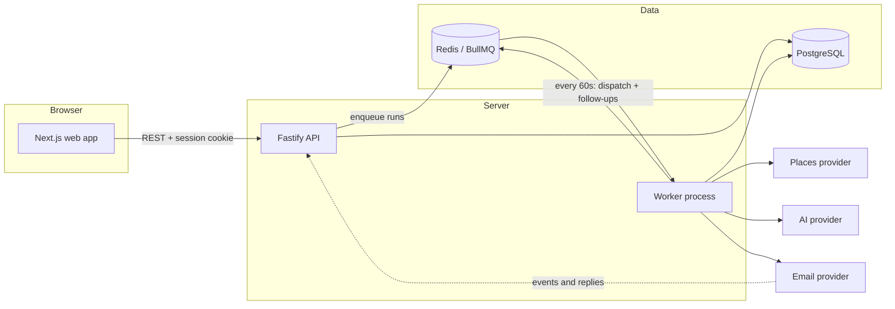

# LeadForge

**Find local businesses that need a website, and win them as clients.**

LeadForge searches an area for businesses (hotels, restaurants, salons, clinics, shops...) that have **no website or a poor one**, scores them as leads, writes a personalised proposal email for each, sends it with the safeguards cold email needs, and tracks every lead until the project is confirmed or lost.

Everything runs on mock providers out of the box, so you can try the full flow with **no API keys and no real emails sent**.

> **Status:** Phases 1-4 are built (discovery, audit, scoring, templates, AI drafts, approval queue, sending, webhooks, unsubscribe, follow-ups, settings). Still to come: the drag-and-drop pipeline board, cron scheduling and the dashboard (Phase 5), then the integration test suite and OpenAPI polish (Phase 6).

---

## How it works

A **campaign** defines where to look (city, or a point and radius), which categories, the filters, the email template, the daily limit and the approval mode. Each **run** moves through these stages. Every stage is idempotent and resumable, so re-running a campaign never duplicates leads or emails.

| # | Stage | What happens |
|---|-------|--------------|
| 1 | **Discover** | Queries a places provider (Google Places API; a mock provider is the default). Official APIs only, no scraping. |
| 2 | **Dedupe** | Skips anything already known, matched by source place ID, normalised phone, or normalised name + address. |
| 3 | **Audit** | Tags each lead `NO_WEBSITE`, `SOCIAL_ONLY`, `BROKEN` (unreachable, timeout, bad SSL), `POOR` or `OK`. Checks HTTPS, mobile viewport, response time, outdated copyright, contact/booking forms and site-builder templates, then gives a 0-100 score and a list of issues. Respects robots.txt and rate-limits per host. |
| 4 | **Enrich** | Looks for a public email on the business's own site (mailto links, contact page). Leads without one go to a "needs manual outreach" bucket (phone/WhatsApp/DM). |
| 5 | **Score** | Configurable weighted score (no website scores highest; a healthy, well-reviewed business scores higher), with a breakdown you can read in the UI. Leads above the threshold become `QUALIFIED`. |
| 6 | **Draft** | Fills your template with the lead's real details and website issues. Optional AI adds 1-2 tailored sentences, and is blocked from inventing facts (see below). |
| 7 | **Review / send** | `REVIEW_FIRST` puts drafts in the approval queue; `AUTO_SEND` sends them within your limits. |
| 8 | **Follow-ups** | Optional +3 day and +7 day follow-ups that stop on reply, unsubscribe, bounce or any status change. |

Leads move through `NEW → QUALIFIED → CONTACTED → REPLIED → INTERESTED → PROPOSAL_SENT → NEGOTIATING → CONFIRMED`, or exit as `LOST`, `NOT_INTERESTED`, `UNSUBSCRIBED` or `BOUNCED`. Each lead has a checklist that ticks automatically from system events, a status timeline, notes and tags.

---

## Architecture



- **Monorepo (pnpm):** `apps/web` (Next.js), `apps/api` (Fastify + Prisma + BullMQ worker), `packages/shared` (Zod schemas, scoring, audit analysis, template rendering, status rules, used by both apps).
- **Providers are interfaces** with a mock and a real implementation: places (`mock` / Google Places), email (`console` / SendGrid), AI (`mock` / Anthropic). Swap with an environment variable.
- **Multi-tenant ready:** every table carries `workspace_id` and every query is scoped by it. The app currently supports one workspace.
- **Reliability:** BullMQ jobs with exponential backoff and a dead-letter queue; run progress is saved per stage so a failed run resumes where it stopped.

---

## Quick start

### Prerequisites

- **Node.js 20+** and **pnpm 9** (`npm i -g pnpm`)
- **Docker Desktop** (runs PostgreSQL and Redis)
- **GNU Make** (optional; every command also works without it)

### One command

```bash
git clone <this repo> && cd lead-gen
make dev
```

`make dev` installs dependencies, creates `.env` from `.env.example`, starts PostgreSQL and Redis, applies migrations, seeds demo data, then runs the API, worker and web app together. Stop with `Ctrl+C`.

| Service | URL |
|---------|-----|
| Web app | http://localhost:3000 |
| API | http://localhost:4000 |
| API docs (Swagger) | http://localhost:4000/docs |

**Demo login:** `admin@leadforge.local` / `changeme123` (created by the seed; change it before exposing the app anywhere).

### Without Make

```bash
pnpm install
cp .env.example .env
docker compose up -d --wait postgres redis
pnpm --filter @leadforge/api db:generate
pnpm --filter @leadforge/api db:deploy      # apply migrations
pnpm db:seed                                # demo workspace, user, leads, templates

# three terminals
pnpm dev:api
pnpm dev:worker
pnpm dev:web
```

### Make targets

Run `make help` for the full list.

| Command | Does |
|---------|------|
| `make dev` | Everything above, then runs API + worker + web |
| `make setup` | Install, env, infra, migrate, seed (no apps) |
| `make api` / `worker` / `web` | Run one process |
| `make infra` / `infra-down` | Start / stop PostgreSQL and Redis |
| `make migrate` / `seed` | Apply migrations / seed demo data |
| `make test` / `typecheck` / `build` | Checks |
| `make stop` | Free ports 3000 and 4000 (Windows) |
| `make psql` / `logs` | Database shell / container logs |
| `make db-reset` | **Deletes all data**, re-migrates and reseeds |

---

## Try the full flow (about 5 minutes, no keys needed)

1. **Settings → Sender & limits:** set your name, company and a **physical address** (required in every email), and the timezone and send window. The default window is 09:00-17:00 in the workspace timezone, so widen it if you test outside those hours.
2. **Campaigns → New campaign:** choose an area (for example `Pune`) and categories (`hotel, salon`). Leave approval on *Review first*.
3. Click **Run now**. Watch the run page: discover, audit, enrich, score, draft. Leads appear under **Leads** with audit results and a score breakdown.
4. **Settings → Scoring:** the "Auto-draft at score" threshold decides which leads get a draft. Lower it if you see no drafts.
5. **Approval queue:** open a draft, edit it if you like, then approve. Use **Send approved now**.
6. Open the lead in **Leads**: the **Emails** tab shows the thread, and the checklist has ticked. With the default `console` email provider nothing leaves your machine; the email is printed in the worker log.
7. **Simulate what happens next** (development only, console provider):
   ```bash
   # replace MESSAGE_ID with an id from GET /api/v1/leads/:id/emails
   curl -b cookies.txt -X POST localhost:4000/api/v1/dev/simulate-event \
     -H 'content-type: application/json' \
     -d '{"messageId":"MESSAGE_ID","type":"REPLY"}'      # or OPEN, CLICK, BOUNCE, SPAM, UNSUBSCRIBE
   ```
   A reply moves the lead to `REPLIED` and stops follow-ups. A bounce or unsubscribe suppresses the address permanently.
8. Move a lead to `CONFIRMED` in the lead sheet; you will be asked for project details. `LOST` and `NOT_INTERESTED` ask for a reason.

---

## Going live

Everything below is optional and independent. Set values in `.env`, or paste API keys in **Settings → API keys** (stored encrypted, and they override `.env`).

| To use | Set | Notes |
|--------|-----|-------|
| Real businesses | `PLACES_PROVIDER=google`, Google Places API (New) key | Uses Text Search; no scraping. |
| Real email | `EMAIL_PROVIDER=sendgrid`, SendGrid key, and a verified **From email** in Settings | Point SendGrid's *Event Webhook* at `POST /webhooks/sendgrid/events` and *Inbound Parse* at the URL shown in Settings (it contains a secret key). Set `SENDGRID_WEBHOOK_PUBLIC_KEY` so events are signature-verified; without it, unsigned events are rejected in production. |
| AI personalisation | `AI_PROVIDER=anthropic`, Anthropic key, `ANTHROPIC_MODEL` | The model name is read from the environment. |

Before sending real email, also set `API_PUBLIC_URL` to the public address of your API: it is used to build unsubscribe links, and they must work.

### Environment variables

Full, documented list in [`.env.example`](.env.example). The main ones:

| Variable | Purpose |
|----------|---------|
| `DATABASE_URL`, `REDIS_URL` | PostgreSQL and Redis connections |
| `JWT_SECRET` | Signs sessions and unsubscribe tokens (32+ characters; change it) |
| `CREDENTIALS_KEY` | 64 hex characters; encrypts stored API keys (`openssl rand -hex 32`) |
| `API_PUBLIC_URL`, `WEB_PUBLIC_URL` | Public addresses, used in links and CORS |
| `PLACES_PROVIDER`, `EMAIL_PROVIDER`, `AI_PROVIDER` | `mock`/`google`, `console`/`sendgrid`, `mock`/`anthropic` |
| `ANTHROPIC_MODEL` | Model used for email personalisation |

The API refuses to start with an invalid environment and tells you what is wrong.

---

## Compliance and safety

These are built in, not optional:

- **Every email** carries a working unsubscribe link (and `List-Unsubscribe` one-click headers), plus your name and physical address. Sending is blocked until the address is set.
- **Suppression list** is checked when a draft is approved *and again at the moment of sending*. Unsubscribes, bounces and spam complaints are added automatically, and those leads are never emailed again.
- **Limits:** per-day and per-hour caps, a per-campaign daily limit, a send window in your timezone, a per-recipient-domain gap, and an optional warm-up ramp (5/day, growing 1.5x per day). Anything over a limit waits for the next window.
- **Region warnings:** campaigns aimed at regions that commonly require opt-in (UK, EU, Canada, Australia and others) show a warning before you send. This is informational, not legal advice; record your own notes under Settings → Jurisdiction.
- **No invented facts:** AI output is rejected if it contains a number that is not in the lead's data, a link, an email address or a price. Rejected output falls back to a fact-only sentence and shows a warning.
- **Responsible auditing:** official APIs for discovery; website audits respect robots.txt, identify themselves, throttle per host, and refuse private/internal addresses.
- **Data deletion:** `DELETE /api/v1/leads/:id/data` and `POST /api/v1/data-deletion` (by email or domain) erase a lead and add its addresses to the suppression list. Only publicly listed business contact data is stored.

---

## Pages

| Page | What it does |
|------|--------------|
| **Leads** | Searchable, sortable table with status filter. Bulk "Queue email". The lead sheet shows the audit, score breakdown, contacts, emails, checklist, timeline and notes. |
| **Campaigns** | Create, run, pause and resume. Run pages show live stage progress, counts and logs, with cancel and resume. |
| **Templates** | Versioned editor with variable picker, live preview against a real lead, tone and AI toggle, and "send test to me". |
| **Approval queue** | Review, edit, approve, reject or regenerate drafts in bulk. Shows today's send count against the limit. |
| **Settings** | Sender identity, limits and send window, scoring weights, suppression list, encrypted API keys, checklist defaults. |
| Dashboard, Pipeline | Placeholders until Phase 5. |

**Template variables:** `{{business_name}}`, `{{owner_name|there}}`, `{{category}}`, `{{area}}`, `{{website_issues}}`, `{{ai_note}}`, `{{rating}}`, `{{review_count}}`, `{{sender_name}}`, `{{sender_company}}`, `{{portfolio_link}}`, `{{unsubscribe_link}}`. `{{name|fallback}}` uses the fallback when the value is empty. Four default templates are seeded (no website, poor website, follow-up 1, follow-up 2).

---

## Project structure

```
apps/
  api/        Fastify API, Prisma schema + migrations, BullMQ worker
    prisma/     schema.prisma, migrations, seed
    src/
      routes/     HTTP routes (auth, leads, campaigns, templates, drafts, settings, sending, public)
      services/   orchestrator, run stages, drafts, sender, events, compliance
      providers/  places, email, ai (mock + real)
      lib/        polite fetcher, secrets, unsubscribe tokens
  web/        Next.js app (App Router, Tailwind, shadcn/ui)
packages/
  shared/     Zod schemas, scoring, audit analysis, template rendering, status rules, tests
docker-compose.yml   PostgreSQL, Redis (and optional api / worker / web images)
Makefile             Developer commands
```

## Tests and checks

```bash
make test        # unit tests (scoring, dedupe keys, rendering, AI guard, transitions, limits)
make typecheck   # all packages
make build       # production build of the web app
```

An integration test for a full run with mocked providers, and generated OpenAPI polish, are planned for Phase 6.

## Troubleshooting

- **`docker ... pipe ... dockerDesktopLinuxEngine` error:** start Docker Desktop and run `make infra` again.
- **Emails stay "approved and waiting":** check the send status strip in the Approval queue. Usually you are outside the send window (Settings), at a daily or hourly limit, or the worker is not running (`make worker`).
- **Run stays queued:** the worker is not running.
- **No drafts after a run:** no qualified lead with a public email met the "Auto-draft at score" threshold. Lower it in Settings → Scoring, or select leads and use **Queue email**.
- **Unsubscribe link goes to the wrong address:** set `API_PUBLIC_URL`.
- **Port already in use:** `make stop` (Windows), or change `API_PORT`.
- **Start over:** `make db-reset` (deletes all local data).

## Docker

`docker-compose.yml` also defines `api`, `worker` and `web` services (`docker compose up --build`). Day-to-day development uses `make dev`; the images are provided for deployment and have not been run in production yet.
